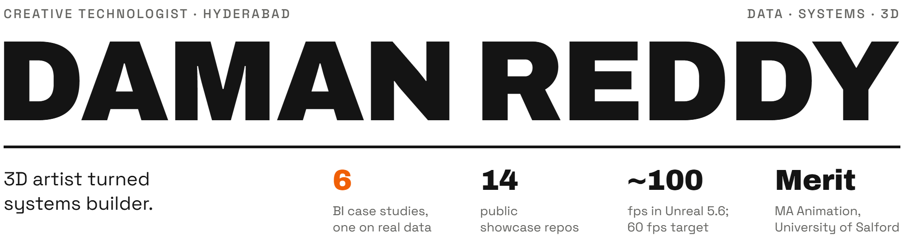

<picture>
  <source media="(max-width: 600px) and (prefers-color-scheme: dark)" srcset=".github/assets/header-phone-dark.png">
  <source media="(max-width: 600px) and (prefers-color-scheme: light)" srcset=".github/assets/header-phone-light.png">
  <source media="(prefers-color-scheme: dark)" srcset=".github/assets/header-dark.png">
  <source media="(prefers-color-scheme: light)" srcset=".github/assets/header-light.png">
  
</picture>

I ship local-first software with AI as the co-pilot, build worlds in Unreal and Blender, and turn messy records into reports people can act on.

[Portfolio](https://damanjz.github.io/portfolio/) · [Tableau Public](https://public.tableau.com/app/profile/daman.reddy) · [ArtStation](https://www.artstation.com/damanpsd) · [LinkedIn](https://www.linkedin.com/in/daman-reddy) · [daman.w3d@gmail.com](mailto:daman.w3d@gmail.com)

### Data and BI

Six end-to-end case studies, five on synthetic data and one on real government monitoring data. SQL model in DuckDB, automated checks that gate every export, reports generated from code.

- **[India air quality](https://github.com/damanjz/india-air-quality-bi)**, real data: 36.1M valid readings from 107 stations. 423 of 423 report figures match SQL.
- **[SaaS revenue leaks](https://github.com/damanjz/saas-revenue-leak-bi)**: dbt star schema and a leak monitor. 5 of 5 planted leaks found blind.
- **[Supply chain](https://github.com/damanjz/supply-chain-bi)**: 14-day stockout AUC 0.840 vs 0.699 for the reorder-point rule. [Live dashboard](https://public.tableau.com/app/profile/daman.reddy/viz/SupplyChainNetwork_17913286536000/Network)
- **[Hospital operations](https://github.com/damanjz/hospital-operations-bi)**: 30-day readmission AUC 0.786 vs 0.749 for the LACE index.
- **[HR analytics](https://github.com/damanjz/hr-analytics)**: flight-risk model, ROC AUC 0.658, sensitive attributes excluded. [Live dashboard](https://public.tableau.com/app/profile/daman.reddy/viz/HRAnalyticsWorkbench/Workbench)
- **[Personal finance](https://github.com/damanjz/personal-finance-bi)**: 15 reconciliation checks gate the Power BI export.

### Systems

- **[protec](https://github.com/damanjz/protec)**: local password manager; Rust core, Tauri and Svelte app, browser extension. 16 hardening fixes from a six-area audit.
- **[openfill](https://github.com/damanjz/openfill)**, beta: Generative Fill, Remove and Expand for Photoshop, on your own OpenAI or Gemini key. 23 of 23 self-test scenarios pass in Photoshop 27.10.
- **[ai-calendar](https://github.com/damanjz/ai-calendar)**: calendar with a REST API that AI assistants book into, behind one conflict check. 177 tests, 96% line coverage in CI.
- **[obsidian-vault-mcp](https://github.com/damanjz/obsidian-vault-mcp)**: read-only MCP server that lets AI assistants search an Obsidian vault. 49 tests; 215 notes indexed in 87 ms.
- **[n8n-ai-triage](https://github.com/damanjz/n8n-ai-triage)**: email triage on local Ollama, drafts held for human approval. 88% routing vs 70% for keyword rules, on 40 labelled emails.
- **[flux-player](https://github.com/damanjz/flux-player)**: native Windows video player in Python and PySide6. No web view.
- **[volt-techwear-store](https://github.com/damanjz/volt-techwear-store)**: Next.js 15 storefront with accounts, Prisma, Postgres and server-side checkout. [Live store](https://volt-techwear-store.vercel.app)
- **[portfolio](https://github.com/damanjz/portfolio)**: the static site behind my portfolio. 0 third-party requests, measured.

### 3D

- **Umbraixs**: semi-stylized medieval village in Unreal Engine 5.6, my MA Animation final project (Merit, University of Salford). About 100 fps against a 60 fps target. [Walkthrough](https://www.youtube.com/watch?v=BFrPzJXAXRU) · [ArtStation](https://www.artstation.com/damanpsd)
- **Studies**: product lighting, procedural cities and clouds, night and interior lighting in Blender. [ArtStation](https://www.artstation.com/damanpsd) · [Portfolio](https://damanjz.github.io/portfolio/)

### How I work

- **Tested pipelines.** A check only counts once it has been seen to fail on deliberately broken data.
- **Numbers reconcile.** Power BI and Tableau figures match an independent DuckDB query, value for value.
- **Local-first.** Data stays on the user's disk; nothing I build needs my server to keep working.
